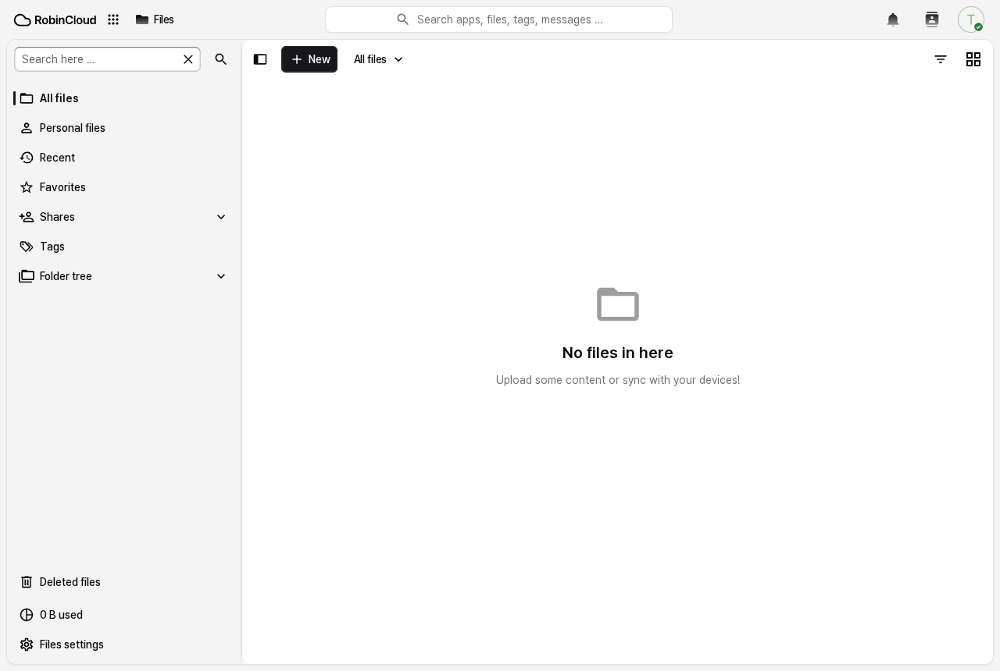
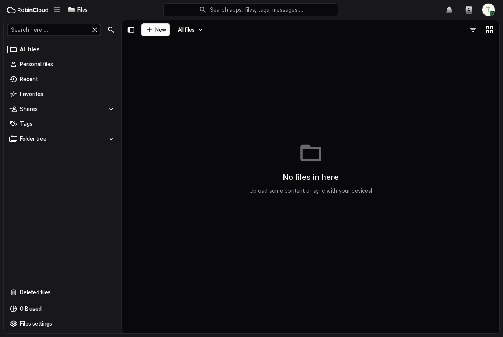
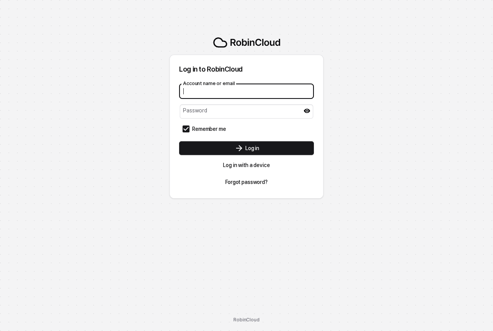
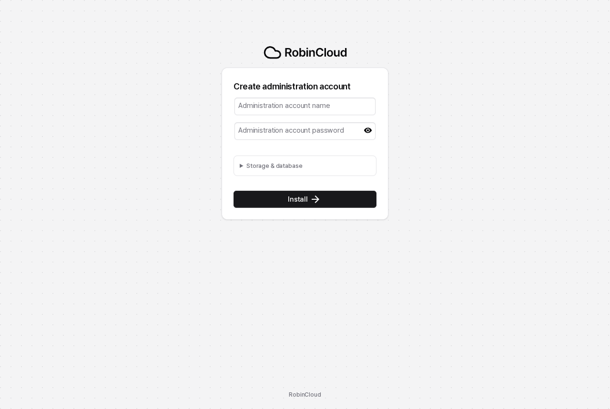

<p align="center">
  <picture>
    <source media="(prefers-color-scheme: dark)" srcset="core/img/logo/logo.svg">
    
  </picture>
</p>

<p align="center">
  Nextcloud 34 기반 개인 파일 저장소. 화면은 shadcn/ui 스타일로 다시 입혔습니다.
</p>

<p align="center">
  
  
</p>
<p align="center">
  
  
</p>

## Nextcloud와 다른 점

**이름과 로고**
- 제품 이름, 브라우저 탭, 메일, 상태 API(`status.php`)가 모두 RobinCloud
- 로고와 파비콘은 lucide 구름 아이콘에 Pretendard로 그린 워드마크
- 슬로건 없음

**화면**
- 모든 화면에 [`core/css/robincloud.css`](core/css/robincloud.css)를 입힙니다. 설치·로그인 화면도 포함이에요.
  - zinc 팔레트, 얇은 테두리, 6~12px 모서리, 초점 링
  - 라이트·다크 모드 둘 다
- 배경 그림 대신 zinc 바탕을 깔고, 앱은 테두리 있는 흰 카드 위에 올립니다.
- 폰트는 Pretendard Variable

**기본값**
- 새 계정은 샘플 파일 없이 빈 상태로 시작
- Nextcloud 첫 실행 안내, 공지, 설문, 지원 앱은 이미지에서 뺐습니다.
- 디자인 파일이 바뀌면 CSS 주소도 바뀝니다. 브라우저가 옛 화면을 붙잡고 있지 않아요.

## 파일 중심 구성

RobinCloud는 파일 저장소로만 씁니다. 토크·메일·연락처·메모·오피스·대시보드는 빼고, 첫 화면은 파일입니다.
Office 앱은 이미지에서 빠져 있고, 나머지는 설치한 뒤 한 번 아래를 실행합니다.

```bash
occ() { docker compose exec -T -u www-data robincloud php occ "$@"; }
for a in spreed mail contacts notes richdocuments richdocumentscode; do occ app:remove $a; done
for a in dashboard weather_status related_resources contactsinteraction user_status circles webhook_listeners; do occ app:disable $a; done
occ config:system:set defaultapp --value=files
occ config:system:set profile.enabled --value=false --type=boolean
```

미리보기: 이미지에 ffmpeg가 들어 있어 영상 썸네일이 나옵니다. 영상·아이폰 사진(HEIC)·WebP·PDF 미리보기를 켜고,
새로 올라온 파일의 썸네일은 10분마다 미리 만들어 둡니다(Preview Generator).

```bash
docker compose cp robincloud-previews.json robincloud:/tmp/previews.json
occ config:import /tmp/previews.json
occ app:install previewgenerator
occ config:app:set previewgenerator squareSizes --value="32 256"
occ config:app:set previewgenerator widthSizes --value="256 384"
occ config:app:set previewgenerator heightSizes --value="256"
occ preview:generate-all          # 한 번, 그다음은 cron이 occ preview:pre-generate
```

남는 것: 파일, 공유(링크·메일·다른 서버), 휴지통, 버전, 사진, 미리보기·PDF, 텍스트 편집기, 태그·댓글·알림·활동, 2단계 인증.

## 바꾼 파일

| 파일 | 내용 |
| --- | --- |
| `core/css/robincloud.css` | shadcn 스타일 스킨 |
| `lib/private/TemplateLayout.php` | 스킨을 모든 페이지에 로드, 스킨 버전을 자산 해시에 반영 |
| `lib/private/legacy/OC_Defaults.php` | 이름·기본 색·슬로건 |
| `apps/theming/lib/Themes/DefaultTheme.php`, `DarkTheme.php` | 테마 변수를 zinc 값으로 |
| `core/img/`, `core/fonts/pretendard/` | 로고·파비콘, 폰트 |
| `Dockerfile.robincloud` | 공식 `nextcloud:34.0.5-apache` 위에 이 소스를 얹는 이미지 |
| `robincloud-deploy.sh` | 이미지를 빌드해서 돌아가는 서버에 반영 |

## 빌드와 배포

이 저장소는 `/opt/robincloud/src`에 있고, 서비스는 `/opt/stack`의 Docker Compose로 돌아갑니다.

```bash
bash /opt/robincloud/src/robincloud-deploy.sh
```

스크립트가 하는 일:
1. `robincloud:34.0.5` 이미지를 빌드합니다.
2. 컨테이너를 새로 띄우고, 코드를 데이터 볼륨에 동기화합니다.
   - 버전 번호가 그대로라 공식 이미지는 스스로 동기화하지 않습니다.
   - `config`, `data`, `custom_apps`, `themes`는 건드리지 않습니다.
3. 필요하면 `occ upgrade`를 돌립니다.

## Nextcloud 업데이트 따라가기

`robincloud` 브랜치는 `v34.0.5` 태그에서 갈라졌습니다. 새 버전이 나오면 그 태그를 합치고, Dockerfile의 기반 이미지 버전을 같이 올리면 됩니다.

```bash
git fetch https://github.com/nextcloud/server.git tag v34.0.6 --no-tags
git merge v34.0.6
```

## 라이선스

- RobinCloud는 [Nextcloud](https://github.com/nextcloud/server)를 고친 것이라 **AGPL-3.0**을 따릅니다. 원본 저작권은 Nextcloud GmbH와 기여자들에게 있습니다.
- Nextcloud라는 이름과 로고는 Nextcloud GmbH의 상표이고, 이 프로젝트는 Nextcloud와 관계가 없습니다.
- [Pretendard](https://github.com/orioncactus/pretendard): SIL Open Font License 1.1
- [lucide](https://lucide.dev) 아이콘: ISC

원래 Nextcloud README는 [nextcloud/server](https://github.com/nextcloud/server#readme)에서 볼 수 있습니다.
